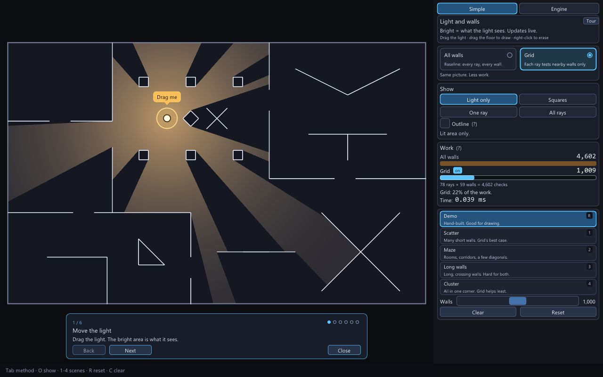
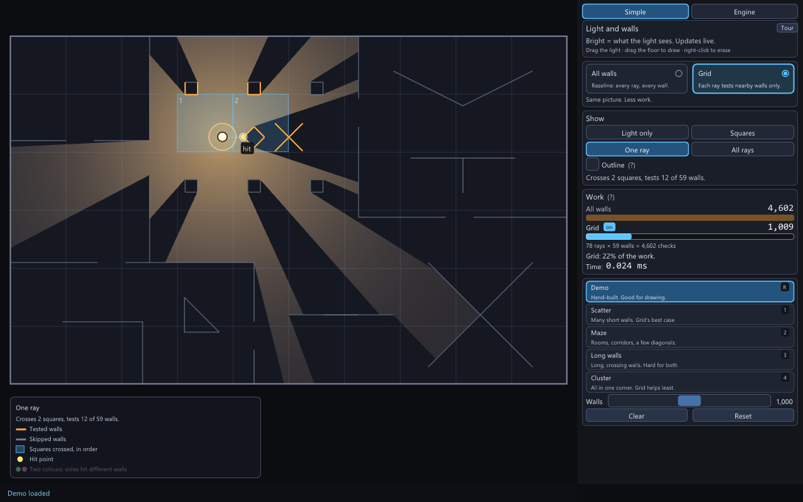
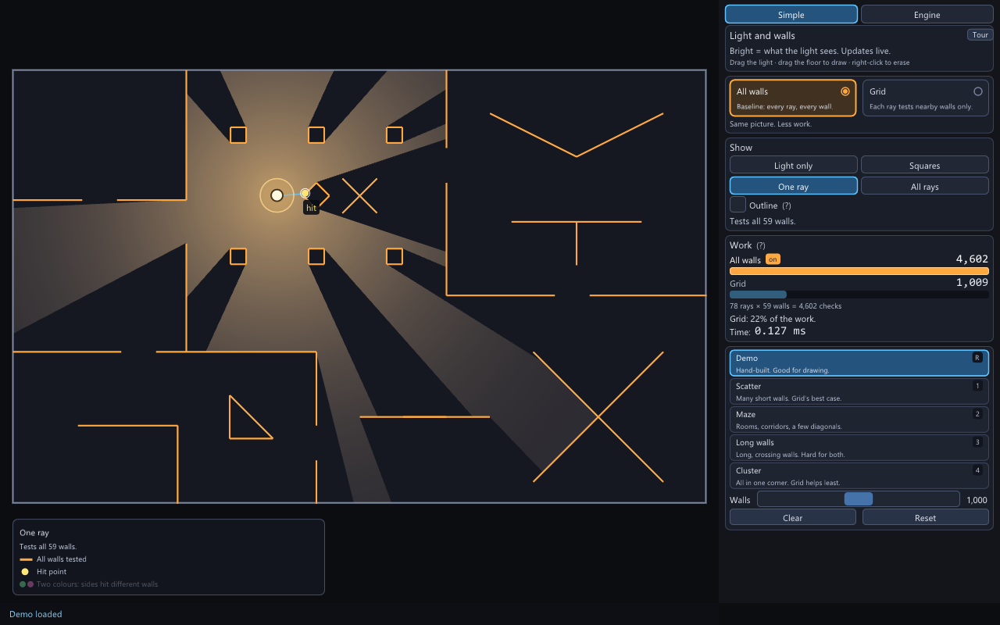
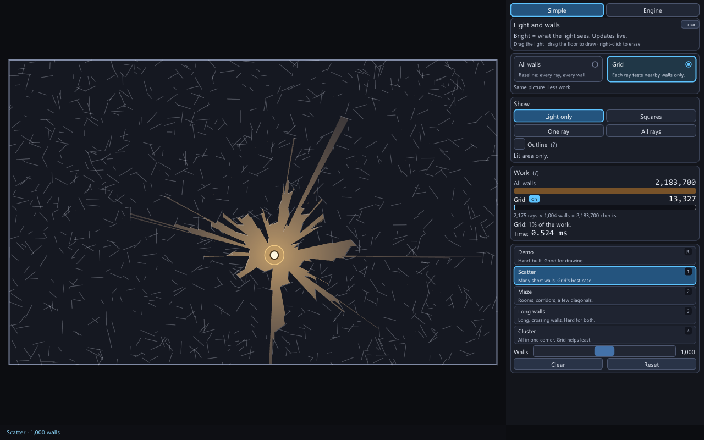
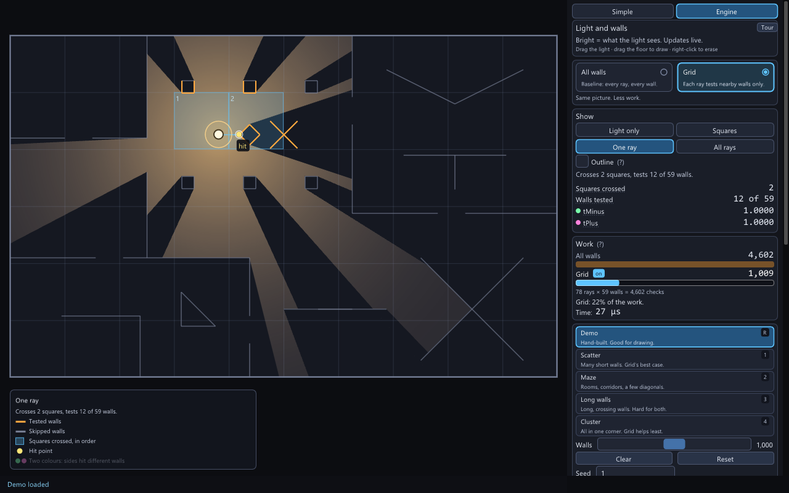
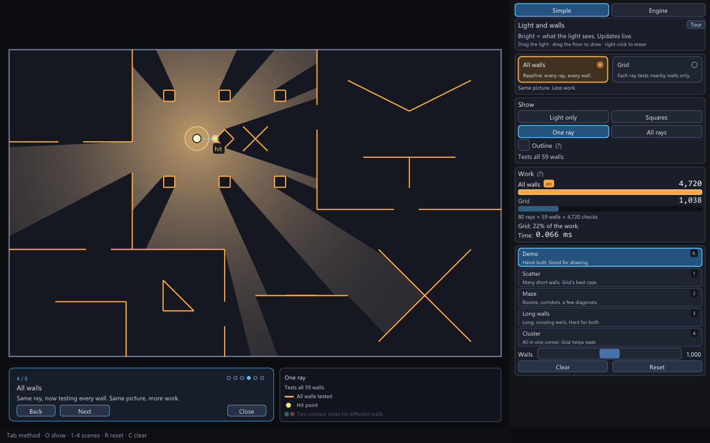
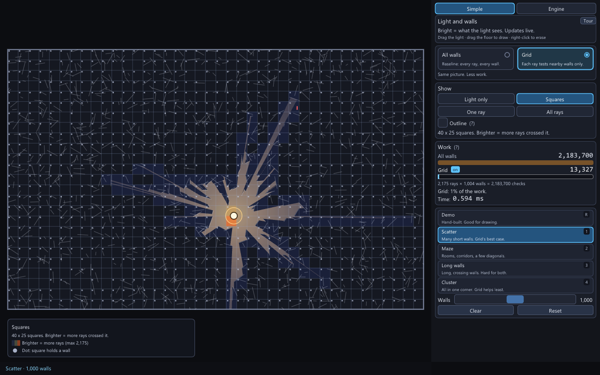
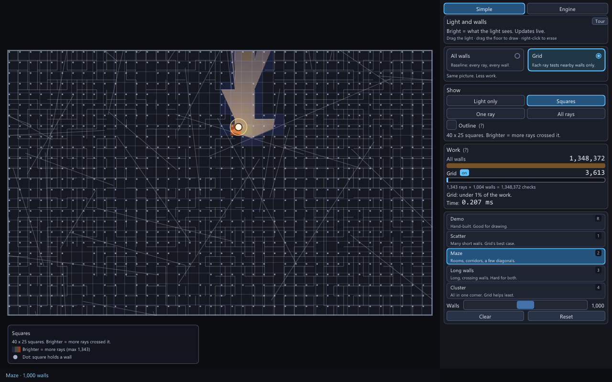
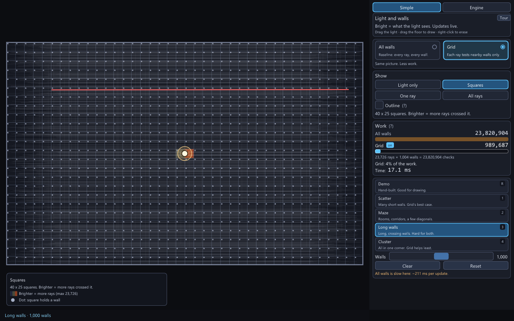
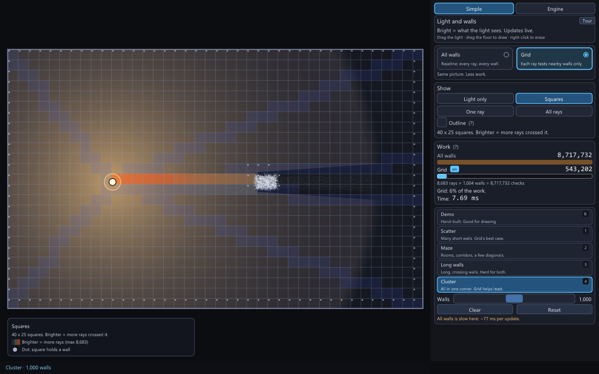

# Real-time 2D Visibility and Lighting Engine

A C++20 library and desktop application that computes, for a point light inside a rectangular world of line-segment walls, the exact region of the world the light can see, and draws it with shadows. The visibility polygon is built by casting one ray at every wall endpoint and every wall-wall crossing and recording the nearest wall hit on each side of the ray (no angular offsets). Two interchangeable back ends produce bit-identical output: a baseline that tests every wall for every ray, and a uniform-grid version that tests only the walls registered in the cells a ray walks through. The desktop application is written for a reader who has never seen the algorithm: you drag the light, draw and delete walls while it runs, switch between the two methods (called "All walls" and "Grid" on screen), watch a work meter that counts how many wall checks each method needs, load scenes of 100-5000 walls, and follow any single ray. A six-step guided tour opens on first launch, and an "Engine" level shows the precise numbers and terms. A headless benchmark compares the two back ends and reports edit costs.



| One ray, "Grid" | One ray, "All walls" |
|---|---|
|  |  |

| The work meter on 1,000 scattered walls | Engine level |
|---|---|
|  |  |



| Scatter | Maze | Long walls | Cluster |
|---|---|---|---|
|  |  |  |  |

All screenshots are real captures of the application (`tests/scripts/captures.script`, 1280x800, converted from BMP to PNG). The bottom row uses the "Squares" view on 1,000 walls.

Documents: [Architecture](docs/ARCHITECTURE.md), [Walkthrough](docs/WALKTHROUGH.md), [Design contract](docs/DESIGN.md), [Decisions](docs/DECISIONS.md), [Benchmark](docs/BENCHMARK.md).

## Verified platform and prerequisites

Everything below was built and run on one machine: Windows 11 Pro (build 26200), Intel Core i7-1355U, Intel Iris Xe Graphics (driver 32.0.101.7088), Visual Studio Build Tools 2022 with MSVC 19.44 (`_MSC_FULL_VER` 194435230), the CMake 3.31.6 and Ninja bundled with the Build Tools, Git 2.55. **Other operating systems, compilers and GPUs are untested.** The project files contain non-MSVC branches (`-Wall`, `-ffp-contract=off`), but they have not been built.

You need:

- Windows 11 and Visual Studio Build Tools 2022 with the "Desktop development with C++" workload (this includes the bundled CMake and Ninja; nothing is installed system-wide by this project). `scripts/dev.ps1` expects them at `C:\Program Files (x86)\Microsoft Visual Studio\2022\BuildTools`; set the environment variable `VIS_VS_PATH` to use another location. The `asan` preset also needs the AddressSanitizer component of the Build Tools.
- Git, and internet access for the first configure: it fetches GLFW 3.4, Dear ImGui v1.92.9 (when building the app) and doctest v2.4.12 (when building the tests) with CMake `FetchContent`.
- A GPU and driver with OpenGL 3.0 or newer. The application sets no context-version hint (GLFW default context) and initialises the Dear ImGui OpenGL3 backend with GLSL `#version 130` (`app/main.cpp`), which is what sets the minimum. Only the Intel Iris Xe listed above was exercised; its OpenGL version string was not recorded.

## Build, test, run, benchmark

All commands are run in PowerShell from the repository root. `scripts/dev.ps1` imports the MSVC x64 developer environment for one command, puts the bundled CMake and Ninja on `PATH`, and restores your environment afterwards.

```powershell
# configure and build (release); first run downloads the dependencies
.\scripts\dev.ps1 cmake --preset release
.\scripts\dev.ps1 cmake --build --preset release

# tests: vis_tests (doctest), app_script and app_script_missing (scripted interaction, script-load failure), bench_quick (benchmark smoke run)
.\scripts\dev.ps1 ctest --preset release
.\scripts\dev.ps1 ctest --preset release -L app      # only the app tests (interaction script, missing-script check)
.\scripts\dev.ps1 ctest --preset release -L bench    # only the benchmark smoke run

# run the application
.\build\release\app\vis_app.exe

# benchmark: quick smoke run (about 2 s) and the full matrix (22 minutes on the verified machine: `done in 1340.1 s`)
.\build\release\bench\vis_bench.exe --out build\bench_quick\results.csv --quick
.\build\release\bench\vis_bench.exe --out bench\results\results.csv
```

Other presets (`CMakePresets.json`): `debug` (Debug) and `asan` (RelWithDebInfo with MSVC `/fsanitize=address`, core, tests and benchmark only). They are used the same way, e.g. `.\scripts\dev.ps1 ctest --preset debug`. The debug and asan presets divide the random-trial counts of the tests by 5 and 8 (`VIS_TEST_SCALE`). To build without GLFW and Dear ImGui (core, tests, benchmark only):

```powershell
.\scripts\dev.ps1 cmake -S . -B build\no-app -G Ninja -DCMAKE_BUILD_TYPE=Release -DVIS_BUILD_APP=OFF
.\scripts\dev.ps1 cmake --build build\no-app
.\scripts\dev.ps1 ctest --test-dir build\no-app
```

**What was run for this README**, from clean `build\release` and `build\no-app` directories: configure (exit 0, 26 s), build (exit 0, 42 s, 0 compiler warnings), `ctest --preset release` (3 of 3 passed at that time: `bench_quick`, `vis_tests`, `app_script`; CTest now has a fourth test, see below), `ctest -L app` (1 of 1), `ctest -L bench` (1 of 1), the `vis_bench --quick` line (exit 0), the `vis_app --script tests\scripts\main.script` line (exit 0, "script ok"), a `vis_app ... --capture` line with most flags (exit 0), the `no-app` configure, build and `ctest` (2 of 2: `bench_quick`, `vis_tests`; `_deps` contained only doctest). The debug and asan presets were configured, built and passed `ctest` in the same working tree (3 of 3 and 2 of 2). The full `vis_bench` run is not repeated here; its output is `bench/results/`. Test counts in that tree: 60 `vis_tests` cases, 757,017 assertions (release), 419,725 (debug), 393,784 (asan).

Since then CTest has a fourth test, `app_script_missing` (label `app`): a missing `--script` file must make `vis_app` exit with code 2 and print "cannot read script". `ctest --preset release` is now 4 of 4 (`app_script` takes about 8-10 s) and `ctest --preset debug` 4 of 4 in about 133 s in total (`app_script` about 91 s; it took about 7 minutes before). `ctest -L app` now runs 2 tests. The assertion counts above were not re-counted after the later changes; they did not touch `vis_tests`.

## Using the application

The window has the room (the world, letterboxed) on the left, a panel on the right, a strip below the room that holds the legend and the tour card, and a one-line status bar at the bottom ("Tab method · O show · 1-4 scenes · R reset · C clear" until a short message such as "Added · 56 walls" replaces it). The smallest window size is 900 x 600. At launch the window and that minimum are scaled by the display's DPI scale (`GLFW_SCALE_TO_MONITOR`, interactive runs only); moving the window to a monitor with a different scale does not rescale the interface. This was not verified on a scaled display: this machine's behaviour at 150% or 200% scaling was not tested. A "Drag me" tag points at the light until you have dragged it once.

### Two levels: Simple and Engine

The two buttons at the top of the panel switch the level. **Simple** (the default) uses plain words and fits a 1280 x 800 window without scrolling. **Engine** adds the precise numbers and terms; every number there is the same one the first version of the application showed, with the same meaning. Hovering a `(?)` or a row label explains the term in one sentence.

Panel, top to bottom:

| Section | What it does |
|---|---|
| "Light and walls" | "Bright = what the light sees. Updates live.", the hint "Drag the light · drag the floor to draw · right-click to erase", and a "Tour" button |
| Method cards | **All walls** ("Baseline: every ray, every wall.") is the Baseline back end (called Baseline in the first version of the interface, the benchmark and these documents; `Brute` in the code and `--mode brute`): every ray is tested against every wall. **Grid** ("Each ray tests nearby walls only.") is the Grid back end: a ray only tests the walls in the grid squares it crosses. Under the cards: "Same picture. Less work." Both give exactly the same picture. The card in use is highlighted |
| Show | **Light only** (overlay `off`), **Squares** (`grid`, formerly "Grid cells": squares tinted by how many rays crossed them), **One ray** (`probe`, formerly "Probe ray": the ray nearest the cursor, the squares it crossed and the walls it tested), **All rays** (`rays`). A caption under the choice describes what is on screen in one live sentence, for example "Lit area only.", "40 x 25 squares. Brighter = more rays crossed it.", "No grid in All walls. Lines are rays.", "Hover the room to pick a ray.", "Crosses 2 squares, tests 12 of 59 walls.", "Tests all 59 walls." or "78 rays: one per wall end or crossing." "Outline" (formerly "Outline visibility polygon") draws the edge of the lit region, the visibility polygon. In Engine the probe's numbers are listed here: squares crossed, walls tested "X of N", `tMinus`, `tPlus` |
| Work | The work meter, below |
| Scene cards | **Demo** (key `R`), **Scatter** (`1`), **Maze** (`2`), **Long walls** (`3`), **Cluster** (`4`), each with a one-line description (for example "Many short walls. Grid's best case."). The **Walls** slider picks 100, 250, 500, 1,000, 2,000, 3,000 or 5,000 walls for the generated scenes; releasing it rebuilds the current generated scene (it does nothing to the demo room). **Clear** (`C`) and **Reset** (`R`). A short orange note appears under the cards when "All walls" would take about 30 ms or more per update in the current scene, for example "All walls is slow here: ~246 ms per update." |
| Engine only | Numbers, Edit cost, Compare, Grid size and a key list, plus a Seed field under the scene cards (see below) |

The strip under the room shows the **legend** for the selected overlay (what the orange, grey, cyan and gold marks mean) and, while the tour is open, the **tour card**. On a narrow window they stack and the legend shortens. Legend titles and rows, under the live caption: **Squares** ("Brighter = more rays (max N)", "Dot: square holds a wall"; in All walls mode the one row is "One ray"); **One ray** ("Tested walls" or, in All walls, "All walls tested"; "Skipped walls"; "Squares crossed, in order"; "Hit point"; "Two colours: sides hit different walls", drawn dimmed when the probed ray's two sides end at the same wall); **All rays** ("Ray, to where it stops"). The probe markers on the ray read "hit", "stops here" and "other side reaches here".

Walls are drawn fainter in dense scenes: the opacity falls with the wall count above 400 walls and also with the total wall length, so Long walls at 1,000 walls is drawn much fainter. Skipped walls in the One ray view fade the same way.

#### The work meter

"Work" compares the two methods in **wall tests**: one wall test is one ray checked against one wall. Two bars share one linear scale (a non-zero value is never drawn thinner than 3 px; the true number is printed above the bar), the method in use is tagged "on", and a sentence states the ratio ("Grid: 22% of the work."). Below the bars the application prints the arithmetic, for example `78 rays × 59 walls = 4,602 checks`, then **Time:** the median of the last (up to) 60 real timed queries of the method in use, shown in milliseconds in Simple and in microseconds or milliseconds in Engine.

Where the two numbers come from (`App::updateMeter`, `app/app.cpp`; `WorkMeter`, `app/app.h`):

- **All walls = rays x walls.** Exact arithmetic, not an estimate: Baseline tests every wall for every ray, and the interaction script checks that the counter measured in Baseline mode equals this product. "Rays" is the ray count of the latest timed query; "walls" includes the 4 outer walls.
- **Grid = wall tests measured for the current light position.** With the grid in use, it is the wall-test counter of the timed query. In Baseline with "Run both" on, it is the counter of the timed Grid query that runs alongside. In Baseline with Compare off there is no Grid query, so the application runs **one extra Grid query per update** purely to read this counter. That pass is not timed and its result is never added to any displayed time. The two ways give the same count for the same light position (the script checks this).
- **When the extra pass is skipped.** If rays x walls is above 20,000,000 (`kMeterSkipTests`) the extra pass is not run while the light or the scene is changing, so "All walls" never gets slower for the meter's sake. The grid bar then shows "not measured" on a dashed track, and the sentence reads "Measuring when you stop." One update later, once nothing is changing, the application runs one untimed extra Grid pass and the real figure appears (`meter_source` is then `extra_pass`). Before this change the figure was never measured in All walls mode on such scenes. The threshold is a work count, not a time, so it is the same on every machine.
- The sentence changes to "Grid saves little" when the grid does 90% or more of the baseline work (followed by ": walls packed in few squares." or ": long walls fill many squares." when the scene shows it) and to "Grid: under 1% of the work." below 1%.
- Updates slower than 50 ms are repeated only once more after a change (`settle` in `App::updateVisibility`) instead of the usual 8 times, which is just enough to finish the meter.
- The orange slow-scene note estimates a Baseline update as the measured query time when Baseline is in use, and otherwise as rays x walls x the cost of one wall test, measured once on a 1,000-wall Scatter scene the first time it is needed. The 30 ms limit is `kSlowMs`.

#### Guided tour

Six steps, shown in a card under the room with a counter such as "1 / 6": Move the light; Draw walls (draw and remove a wall); One ray (grid); All walls (the same ray, now testing everything); More walls (1,000 scattered walls and the meter); Worst case (1,000 walls packed in one corner, where the grid helps least). Each step sets the scene, method and overlay it talks about, and **Next** moves on whether or not you did what the card suggested. **Back**, **Close**, `Esc` and the final **Done** step back or close it; "Tour" in the panel starts it again from step 1 on the demo room (`App::tourStart`, `app/tour.cpp`).

The tour **starts by itself** only in a plain interactive launch: no `--scene`, `--walls`, `--seed`, `--mode`, `--overlay`, `--light` or `--compare` flag, and no `--capture` or `--script`. `--tour` starts it explicitly (`app/main.cpp`).

### Mouse and keys

| Input | Effect |
|---|---|
| Left-drag starting on the light handle (grab radius 22 px with up to 400 user walls, 18 px up to 1,500, 16 px above; multiplied by the display scale) | Move the light; it stays inside the world. Cursor: hand over the handle, four-way arrow while dragging |
| Left-drag elsewhere on the room | Draw a wall (rubber band, crosshair cursor); release adds it. A rejected wall shows the reason in the status bar |
| Shift held while drawing | Snap the wall's end points to existing wall end points within 8 px |
| Right-click within 8 px of a wall | Delete that wall (it is highlighted while hovered). User walls are looked up first, so one lying on the world edge can be deleted; the four outer walls are not deletable and the status bar says so |
| `Tab` or `M` | Switch between "All walls" and "Grid". The scene and the light are untouched |
| `R` | Reset to the demo room (same as the Demo card and the Reset button) |
| `C` | Remove all user walls |
| `O` | Cycle Show: Light only, Squares, One ray, All rays |
| `1` `2` `3` `4` | Load Scatter, Maze, Long walls or Cluster (wall count from the slider, seed from the Seed field) |
| `Esc` | Cancel the wall being drawn; also closes the tour |

Keys and mouse presses are ignored while a text field has focus or when the press lands on the panel or the tour card; a drag that started on the room keeps working if the cursor crosses the panel. In Engine the panel also has the Seed field, **Run both** (card "Compare", formerly "Compare both modes"; a table of both methods' median query time and wall tests, their time ratio, and "Identical: yes"; both methods then run on every update and the order alternates), **Grid size** ("Auto", or manual sliders of 1-256 squares per axis) and the numbers listed above.

### Showing it to someone

A two-minute walkthrough, in order:

1. Start `vis_app.exe`. The tour opens on step 1 ("1 / 6"). Drag the light around the demo room for ten seconds: the bright area is exactly what it can see.
2. Click **Next**. Drag on empty floor to draw a wall, right-click it to remove it.
3. Click **Next**. Move the mouse over the room: the orange walls are the only ones that ray had to test.
4. Click **Next**. The same ray now tests every wall (all orange). The picture has not changed.
5. Click **Next**. 1,000 short walls load. Point at the work meter: in the captured run, 13,327 wall tests with the grid against 2,183,700 for checking every wall (the figures depend on where the light is).
6. Click **Next**. The walls are packed into a corner and the grid saves less. Click **Done**.
7. Click **Engine**, tick **Run both**, and show "Identical: yes" and the two methods' times.

### A longer demonstration

Everything in the tour, then:

1. Press `R`, choose **One ray** (`O`), and in Engine read the probe numbers: squares crossed, walls tested "X of 59", and the two limits `tMinus` and `tPlus`.
2. Press `Tab`. The probe now reports every wall tested, and the **Squares** view has no tinted squares: Baseline has no grid. The lit area does not change.
3. Press `Tab` again, tick **Run both** and read the query times, wall tests and "Identical: yes".
4. Click **Maze** (or press `2`) and choose **Squares**: squares are tinted by how many rays crossed them, and the legend states the busiest count. Numbers show walls, crossings k, targets T, wall tests and squares walked.
5. Click **Long walls**, switch to **All walls** and read the orange slow-scene note. Compare the two bars: the grid cuts the tests per ray but not the number of rays (see [BENCHMARK.md](docs/BENCHMARK.md), "Where the grid loses").
6. Draw a wall; "Edit cost" shows what the rebuild cost, paid once per edit. Right-click it to delete it, and right-click an outer wall to see the refusal message.
7. Press `R` to return to the demo room.

### Command-line flags

`vis_app [--size WxH] [--scene demo|scatter|maze|long|cluster] [--walls N] [--seed S] [--mode brute|grid] [--overlay off|grid|probe|rays] [--light x,y] [--compare] [--tour] [--capture file.bmp [--frames N]] [--script file]`

`--mode brute` selects "All walls" (Baseline) and `--mode grid` "Grid". `--walls` is clamped to 100-5000. `--size` is clamped to 400-7680 by 300-4320, and the window cannot be resized below 900 x 600 (both scaled by the display's DPI scale in interactive runs; headless runs stay at 100%). `--tour` opens the guided tour (see above). `--capture` renders N frames (default 3), writes a 24-bit BMP (parent directories are created) and exits. `--script` replays a script and exits when it ends. Capture and script runs use a hidden window and no vsync, so the window size is limited by the screen (a `--size 2560x1440` capture produced 1924x1050 on the verified machine).

### Scripts

A script is a text file, one command per line, `#` starts a comment. Events go through ImGui's input queue, so the real canvas input handling runs; real OS mouse and keyboard delivery through GLFW is not exercised, and neither is the cursor shape the OS displays. Commands (documented in `app/script.h`):

- Mouse and keys: `shift on|off` (hold Shift, which snaps a drawn wall to existing end points), `move X Y`, `move @Button Label` (the centre of a panel or tour-card button, for example `move @Engine` or `move @Next`), `wmove X Y` (world coordinates through the app's transform), `down|up left|right`, `key Tab|R|C|O|M|1|2|3|4|Escape`, `wait N` (frames).
- Output: `capture file.bmp`, `log`, `print FIELD...`, `quit`.
- State: `set walls N | seed N | compare on|off | mode brute|grid | overlay off|grid|probe|rays | detail simple|details | tour on|off`.
- Checks: `save NAME FIELD`, `expect FIELD OP VALUE` (`== != < <= > >= has`, the value may be `$NAME`). The process exits non-zero if any `expect` fails.

Variables (the `FIELD` names, all handled in `App::field`, `app/app.cpp`):

- Model: `mode` (`grid` or `brute`), `scene`, `overlay`, `compare`, `detail` (`simple` or `details`), `walls`, `walls_total`, `seed`, `light_x`, `light_y`, `status`, `drawing`.
- Query: `k`, `T`, `rays`, `wall_tests`, `cells`, `vertices`, `identical`, `poly_hash`, `query_us`, `query_median_us`, `median_us_brute`, `median_us_grid`, `tests_brute`, `tests_grid`, `rays_x_walls`, `rebuild_grid_us`, `rebuild_isect_us`, `grid_cols`, `grid_rows`, `grid_regs`.
- Work meter: `meter_rays`, `meter_walls`, `meter_baseline`, `meter_grid` (or `unknown`), `meter_source` (`measured`, `extra_pass` or `skipped`; on heavy scenes in All walls mode it is `skipped` while the light or scene is changing and `extra_pass` one update later), `meter_verdict`, `slow_note`, `slow_ms`, `slow_text`.
- Probe: `probe_cells`, `probe_walls`, `probe_tminus`, `probe_tplus` (`none` when there is no valid probe ray), `legend_pair` (the two-colour legend row under "One ray": `full`, `dim` when both sides of the probed ray end at the same wall, or `none` when the row is not listed).
- Interface: `tour` (`on` or `off`), `tour_step`, `caption`, `cursor` (`arrow`, `hand`, `move` or `cross`), `light_hint`, `panel_overflow`, `panel_scroll`, `panel_slack`, `mouse_x`, `mouse_y`, `scale`, `origin_x`, `origin_y`.

Scripts in `tests/scripts/`: `main.script` (the CTest `app_script`: the canvas interaction checks, including the exact boundary tie (a user wall drawn with Shift from corner to corner, picked before the boundary wall), then checks of the interface: Simple fits without scrolling, the work meter figures in both methods, the slow-scene note, captions, cursors, the tour). The CTest `app_script_missing` checks that a missing script file exits with code 2 and prints "cannot read script", `captures.script` (writes the review captures to `build/captures`), `captures_small.script` (the 900 x 600 capture, run with `--size 900x600`), `measure.script` (prints live measurements per stress scene). The cursor is checked as application state (`cursor`), not as what the OS displays; hands-on use with a physical mouse has not been done.

## Supported geometry and limits

The world is the rectangle `[0, W] x [0, H]` (1600 x 1000 in the application) and its four edges are permanent walls. A wall is a closed, opaque, zero-thickness line segment given by `double` coordinates. Walls may cross, touch, share end points, form T-junctions and overlap collinearly. Wall input is clipped to the world; non-finite coordinates, coordinates of magnitude above 1e150, walls entirely outside, and walls shorter than 1e-6 after clipping are rejected. A wall seen exactly end-on blocks nothing; a light on a wall shines to both sides; the light is clamped into the world. Details and the reasoning are in [ARCHITECTURE.md](docs/ARCHITECTURE.md) and the contract in [DESIGN.md](docs/DESIGN.md).

## Repository layout

```
CMakeLists.txt, CMakePresets.json   build options and the release / debug / asan presets
scripts/dev.ps1                     runs a command inside the MSVC developer environment
core/                               static library viscore (standard library only)
  geometry.*  exact orient, rayHit, segment tests, clipping
  grid.*      uniform grid (CSR cell lists) and the DDA walker
  scene.*     walls, grid, crossings, targets, edit operations
  visibility.* computeVisibility, Trace, statistics
  scenes.*    deterministic demo and stress scene generators, light placement
app/                                vis_app: GLFW + Dear ImGui front end
  main.cpp    window, command-line flags, frame loop, cursors, capture
  app.*       application state, input, queries, work-meter counters, script fields
  ui.cpp      panel (Simple / Engine), status line, fonts and theme
  widgets.*   panel building blocks and the plain-language glossary
  meter.cpp   work meter; details.cpp  Engine panels
  tour.cpp    guided tour; legend.*  legend and the strip under the room
  render.cpp  canvas drawing and overlays; script.*  script runner
bench/                              vis_bench and committed results (bench/results/)
tests/                              doctest suite (vis_tests) and app scripts (tests/scripts/)
docs/                               DESIGN, ARCHITECTURE, WALKTHROUGH, DECISIONS, BENCHMARK, images/
```

## Limitations and possible extensions

These are documented possibilities, not commitments.

- One light only; no light colour, radius or attenuation model. The gradient in the application is cosmetic.
- Hard shadows only: walls have zero thickness and the light is a point.
- Every edit rebuilds the grid, crossings and targets from scratch (cost per edit in [BENCHMARK.md](docs/BENCHMARK.md)); incremental updates are not implemented.
- A ray is cast for every target whether or not it is visible, so scenes with very many crossings are expensive in both modes ([BENCHMARK.md](docs/BENCHMARK.md), "Where the grid loses").
- Possible alternatives, discussed in [DECISIONS.md](docs/DECISIONS.md): an angular sweep with an ordered active set, a quadtree or BVH instead of the uniform grid, multiple lights, a WebAssembly build. None is implemented or tested.
- Single-threaded; no GPU computation.
- Only Windows with MSVC was built and run.
