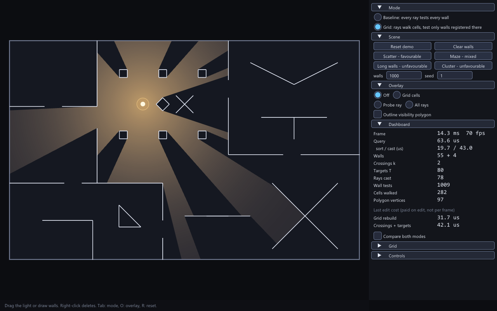
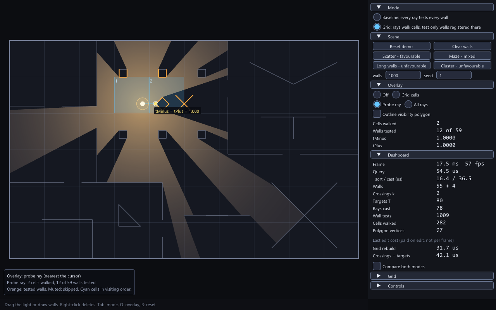
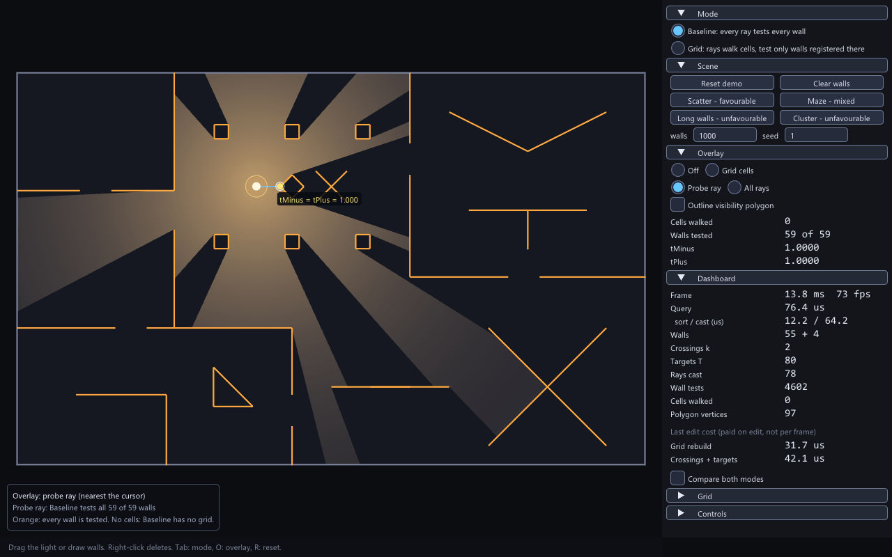

# Real-time 2D Visibility and Lighting Engine

A C++20 library and desktop application that computes, for a point light inside a rectangular world of line-segment walls, the exact region of the world the light can see, and draws it with shadows. The visibility polygon is built by casting one ray at every wall endpoint and every wall-wall crossing and recording the nearest wall hit on each side of the ray (no angular offsets). Two interchangeable back ends produce bit-identical output: a baseline that tests every wall for every ray, and a uniform-grid version that tests only the walls registered in the cells a ray walks through. The application lets you drag the light, draw and delete walls while it runs, switch back ends, compare them, load stress scenes of 100-5000 walls, and overlay the cells walked and walls tested by any ray. A headless benchmark compares the two back ends and reports edit costs.



| Probe ray, Grid mode | Probe ray, Baseline mode |
|---|---|
|  |  |

| Scatter | Maze | Long walls | Cluster |
|---|---|---|---|
|  |  |  |  |

Documents: [Architecture](docs/ARCHITECTURE.md), [Walkthrough](docs/WALKTHROUGH.md), [Design contract](docs/DESIGN.md), [Decisions](docs/DECISIONS.md), [Benchmark](docs/BENCHMARK.md).

## Verified platform and prerequisites

Everything below was built and run on one machine: Windows 11 Pro (build 26200), Intel Core i7-1355U, Intel Iris Xe Graphics (driver 32.0.101.7088), Visual Studio Build Tools 2022 with MSVC 19.44 (`_MSC_FULL_VER` 194435230), the CMake 3.31.6 and Ninja bundled with the Build Tools, Git 2.55. **Other operating systems, compilers and GPUs are untested.** The project files contain non-MSVC branches (`-Wall`, `-ffp-contract=off`), but they have not been built.

You need:

- Windows 11 and Visual Studio Build Tools 2022 with the "Desktop development with C++" workload (this includes the bundled CMake and Ninja; nothing is installed system-wide by this project). `scripts/dev.ps1` expects them at `C:\Program Files (x86)\Microsoft Visual Studio\2022\BuildTools`; set the environment variable `VIS_VS_PATH` to use another location. The `asan` preset also needs the AddressSanitizer component of the Build Tools.
- Git, and internet access for the first configure: it fetches GLFW 3.4, Dear ImGui v1.92.9 (when building the app) and doctest v2.4.12 (when building the tests) with CMake `FetchContent`.
- A GPU and driver with OpenGL 3.0 or newer. The application sets no context-version hint (GLFW default context) and initialises the Dear ImGui OpenGL3 backend with GLSL `#version 130` (`app/main.cpp`), which is what sets the minimum. Only the Intel Iris Xe listed above was exercised; its OpenGL version string was not recorded.

## Build, test, run, benchmark

All commands are run in PowerShell from the repository root. `scripts/dev.ps1` imports the MSVC x64 developer environment for one command, puts the bundled CMake and Ninja on `PATH`, and restores your environment afterwards.

```powershell
# configure and build (release); first run downloads the dependencies
.\scripts\dev.ps1 cmake --preset release
.\scripts\dev.ps1 cmake --build --preset release

# tests: vis_tests (doctest), app_script (scripted interaction), bench_quick (benchmark smoke run)
.\scripts\dev.ps1 ctest --preset release
.\scripts\dev.ps1 ctest --preset release -L app      # only the interaction script
.\scripts\dev.ps1 ctest --preset release -L bench    # only the benchmark smoke run

# run the application
.\build\release\app\vis_app.exe

# benchmark: quick smoke run (about 2 s) and the full matrix (22 minutes on the verified machine: `done in 1340.1 s`)
.\build\release\bench\vis_bench.exe --out build\bench_quick\results.csv --quick
.\build\release\bench\vis_bench.exe --out bench\results\results.csv
```

Other presets (`CMakePresets.json`): `debug` (Debug) and `asan` (RelWithDebInfo with MSVC `/fsanitize=address`, core, tests and benchmark only). They are used the same way, e.g. `.\scripts\dev.ps1 ctest --preset debug`. The debug and asan presets divide the random-trial counts of the tests by 5 and 8 (`VIS_TEST_SCALE`). To build without GLFW and Dear ImGui (core, tests, benchmark only):

```powershell
.\scripts\dev.ps1 cmake -S . -B build\no-app -G Ninja -DCMAKE_BUILD_TYPE=Release -DVIS_BUILD_APP=OFF
.\scripts\dev.ps1 cmake --build build\no-app
.\scripts\dev.ps1 ctest --test-dir build\no-app
```

**What was run for this README**, from clean `build
elease` and `build
o-app` directories: configure (exit 0, 26 s), build (exit 0, 42 s, 0 compiler warnings), `ctest --preset release` (3 of 3 passed: `bench_quick`, `vis_tests`, `app_script`), `ctest -L app` (1 of 1), `ctest -L bench` (1 of 1), the `vis_bench --quick` line (exit 0), the `vis_app --script tests\scripts\main.script` line (exit 0, "script ok"), a `vis_app ... --capture` line with most flags (exit 0), the `no-app` configure, build and `ctest` (2 of 2: `bench_quick`, `vis_tests`; `_deps` contained only doctest). The debug and asan presets were configured, built and passed `ctest` in the same working tree (3 of 3 and 2 of 2). The full `vis_bench` run is not repeated here; its output is `bench/results/`. Test counts in that tree: 60 `vis_tests` cases, 757,017 assertions (release), 419,725 (debug), 393,784 (asan).

## Using the application

The window has a canvas (left) with the world letterboxed into it and a docked panel (right) with the mode, scene, overlay and dashboard sections. Grid and Controls sections are collapsed by default.

| Input | Effect |
|---|---|
| Left-drag starting on the light handle (grab radius 16 px) | Move the light; it stays inside the world |
| Left-drag elsewhere on the canvas | Draw a wall (rubber band); release adds it. A rejected wall shows the reason in the status line |
| Shift held while drawing | Snap the wall's end points to existing wall end points within 8 px |
| Right-click within 8 px of a wall | Delete that wall (it is highlighted red while hovered). User walls are looked up first, so one lying on the world edge can be deleted; the four boundary walls themselves are not deletable and the status line says so |
| `Tab` or `M` | Switch between Baseline and Grid. The scene and the light are untouched |
| `R` | Reset to the demo scene |
| `C` | Remove all user walls |
| `O` | Cycle the overlay: off, grid cells, probe ray, all rays |
| `1` `2` `3` `4` | Load the Scatter, Maze, Long walls or Cluster stress scene (wall count and seed from the panel) |
| `Esc` | Cancel the wall being drawn |

Keys and mouse presses are ignored while a text field has focus or when the press lands on the panel; a drag that started on the canvas keeps working if the cursor crosses the panel. The panel has buttons for the same actions plus: the wall count (100-5000) and seed fields for stress scenes, an automatic/manual grid resolution (manual sliders 1-256 per axis), "Compare both modes", and "Outline visibility polygon".

### A short demonstration

1. Start `vis_app.exe`. The demo scene (55 walls) opens with the light at (610, 290). Drag the light handle and watch the shadows follow.
2. Press `O` twice to select **Probe ray**. Move the cursor over the canvas: the ray nearest the cursor direction is drawn with the cells it walked (numbered), the walls it tested (orange) and its two hit points. The panel shows "Cells walked" and "Walls tested X of 59".
3. Press `Tab` to switch to Baseline. The same probe now reports every wall tested (59 of 59) and zero cells: Baseline has no grid. The polygon on screen does not change.
4. Press `Tab` again, then tick **Compare both modes**. The panel shows both modes' median query time and wall tests, their time ratio, and "Outputs identical: yes". While it is on, both back ends run on every query (the order alternates between queries).
5. Click **Maze - mixed** (or press `2`) and choose the **Grid cells** overlay: cells are tinted by how many rays walked them. Look at the Dashboard: walls, crossings k, targets T, wall tests, cells walked.
6. Draw a wall on empty canvas. The status line shows "Wall added", and "Last edit cost" in the Dashboard shows what the rebuild cost (paid once per edit).
7. Right-click that wall to delete it. Right-click a boundary wall to see the refusal message.
8. Press `R` to return to the demo scene.

### Command-line flags

`vis_app [--size WxH] [--scene demo|scatter|maze|long|cluster] [--walls N] [--seed S] [--mode brute|grid] [--overlay off|grid|probe|rays] [--light x,y] [--compare] [--capture file.bmp [--frames N]] [--script file]`

`--walls` is clamped to 100-5000. `--capture` renders N frames (default 3), writes a 24-bit BMP (parent directories are created) and exits. `--script` replays a script and exits when it ends. Capture and script runs use a hidden window and no vsync, so the window size is limited by the screen (a `--size 2560x1440` capture produced 1924x1050 on the verified machine).

### Scripts

A script is a text file, one command per line, `#` starts a comment. Events go through ImGui's input queue, so the real canvas input handling runs; real OS mouse and keyboard delivery through GLFW is not exercised. Commands (documented in `app/script.h`): `move X Y`, `move @Button Label`, `wmove X Y` (world coordinates through the app's transform), `down|up left|right`, `key Tab|R|C|O|M|1|2|3|4|Escape`, `wait N` (frames), `capture file.bmp`, `log`, `print FIELD...`, `set walls|seed|compare|mode|overlay ...`, `save NAME FIELD`, `expect FIELD OP VALUE` (`== != < <= > >= has`, value may be `$NAME`), `quit`. Fields are listed in `App::field` (`app/app.cpp`). The process exits non-zero if any `expect` fails. Scripts in `tests/scripts/`: `main.script` (the CTest), `captures.script` (writes review captures to `build/captures`), `measure.script` (prints live measurements per stress scene).

## Supported geometry and limits

The world is the rectangle `[0, W] x [0, H]` (1600 x 1000 in the application) and its four edges are permanent walls. A wall is a closed, opaque, zero-thickness line segment given by `double` coordinates. Walls may cross, touch, share end points, form T-junctions and overlap collinearly. Wall input is clipped to the world; non-finite coordinates, coordinates of magnitude above 1e150, walls entirely outside, and walls shorter than 1e-6 after clipping are rejected. A wall seen exactly end-on blocks nothing; a light on a wall shines to both sides; the light is clamped into the world. Details and the reasoning are in [ARCHITECTURE.md](docs/ARCHITECTURE.md) and the contract in [DESIGN.md](docs/DESIGN.md).

## Repository layout

```
CMakeLists.txt, CMakePresets.json   build options and the release / debug / asan presets
scripts/dev.ps1                     runs a command inside the MSVC developer environment
core/                               static library viscore (standard library only)
  geometry.*  exact orient, rayHit, segment tests, clipping
  grid.*      uniform grid (CSR cell lists) and the DDA walker
  scene.*     walls, grid, crossings, targets, edit operations
  visibility.* computeVisibility, Trace, statistics
  scenes.*    deterministic demo and stress scene generators, light placement
app/                                vis_app: GLFW + Dear ImGui front end
bench/                              vis_bench and committed results (bench/results/)
tests/                              doctest suite (vis_tests) and app scripts (tests/scripts/)
docs/                               DESIGN, ARCHITECTURE, WALKTHROUGH, DECISIONS, BENCHMARK, images/
```

## Limitations and possible extensions

These are documented possibilities, not commitments.

- One light only; no light colour, radius or attenuation model. The gradient in the application is cosmetic.
- Hard shadows only: walls have zero thickness and the light is a point.
- Every edit rebuilds the grid, crossings and targets from scratch (cost per edit in [BENCHMARK.md](docs/BENCHMARK.md)); incremental updates are not implemented.
- A ray is cast for every target whether or not it is visible, so scenes with very many crossings are expensive in both modes ([BENCHMARK.md](docs/BENCHMARK.md), "Where the grid loses").
- Possible alternatives, discussed in [DECISIONS.md](docs/DECISIONS.md): an angular sweep with an ordered active set, a quadtree or BVH instead of the uniform grid, multiple lights, a WebAssembly build. None is implemented or tested.
- Single-threaded; no GPU computation.
- Only Windows with MSVC was built and run.
