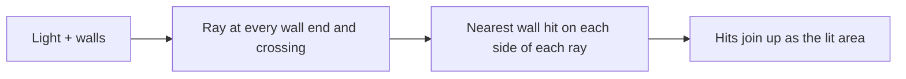

# 2D Visibility and Lighting Engine

Exact hard shadows for a point light among line-segment walls. C++20, with an interactive demo.


- **Exact.** No angular offsets or epsilon tricks; every side-of-line decision uses exact arithmetic.
- **Two methods, one result.** A simple one and a faster one give bit-identical output.
- **Easy to explore.** Drag the light, draw walls, watch how much work each method does.
- **Tested.** 60 test cases, 757,017 assertions, plus a scripted test of the whole app.

## How it works



The only question is *which wall does each ray hit first?* The two methods answer it differently:

| All walls (baseline) | Grid |
|---|---|
| Every ray tests every wall. | Each ray tests only walls in the squares it crosses. |
|  |  |
| Orange = walls tested | Orange = tested, grey = skipped |

## The demo

Two levels, switched at the top of the panel: **Simple** (plain words) and **Engine** (exact numbers).

| Simple | Engine |
|---|---|
|  |  |

| Panel | Does |
|---|---|
| **Method** | Pick *All walls* or *Grid*. |
| **Show** | *Light only*, *Squares* (rays per grid square), *One ray* (follow the ray under the cursor), *All rays*. |
| **Work** | Counts wall tests per method. Same picture, less work. |
| **Scenes** | *Demo*, *Scatter*, *Maze*, *Long walls*, *Cluster*; 100-5,000 walls. |
| **Tour** | Six steps, opens on first launch. |

| Input | Action |
|---|---|
| Drag the light | Move it |
| Drag the floor | Draw a wall (hold `Shift` to snap to wall ends) |
| Right-click a wall | Erase it |
| `Tab` | Switch method |
| `O` | Cycle *Show* |
| `1` `2` `3` `4` | Load a scene |
| `R` / `C` | Reset / clear walls |

### Scenes

| Scatter | Maze | Long walls | Cluster |
|---|---|---|---|
|  |  |  |  |
| Grid's best case | Rooms and corridors | Hard for both | Grid helps least |

All screenshots are real captures at 1,000 walls (`tests/scripts/captures.script`).

More detail: [demo guide](docs/APP.md).

## Run it

Windows, Visual Studio Build Tools 2022:

```powershell
.\scripts\dev.ps1 cmake --preset release
.\scripts\dev.ps1 cmake --build --preset release
.\build\release\app\vis_app.exe
```

Tests, benchmarks and platform notes: [docs/RUNNING.md](docs/RUNNING.md).

## Limits

- One point light, hard shadows, zero-thickness walls.
- Every edit rebuilds the grid; very crossing-heavy scenes are slow in both methods.
- Single-threaded. Built and run on Windows with MSVC only.

## Docs

| | |
|---|---|
| [Demo guide](docs/APP.md) | Every panel, the work meter, the tour |
| [Running](docs/RUNNING.md) | Build, test, run, benchmark, flags, scripts |
| [Architecture](docs/ARCHITECTURE.md) | Algorithms and code layout |
| [Walkthrough](docs/WALKTHROUGH.md) | One query, step by step |
| [Design contract](docs/DESIGN.md) | Exact geometry rules |
| [Decisions](docs/DECISIONS.md) | Why it is built this way |
| [Benchmark](docs/BENCHMARK.md) | Measured results |
| [Status](STATUS.md) | What was checked, what was not |
