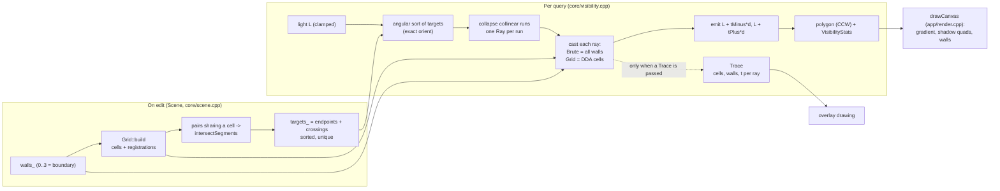

# Architecture

This is how the code works today. The contract it's built against is [DESIGN.md](DESIGN.md). Where the two differ, the differences are in the last numbered section. Measurements are in [BENCHMARK.md](BENCHMARK.md), and the reasoning behind choices is in [DECISIONS.md](DECISIONS.md).

A few terms first:

- **Wall**: a closed line segment.
- **Target**: a wall end point, or a point where two walls cross.
- **Ray**: a line from the light `L` through one target `P`.
- **Visibility polygon**: the part of the world the light can see, as a counter-clockwise list of vertices.
- `n` = number of walls (including the four boundary walls where noted), `k` = number of proper crossings, `T` = number of targets.

## 1. Data flow

Two phases. Editing walls does the heavy prep work. Moving the light only runs the query.



- Moving the light rebuilds nothing.
- An edit rebuilds the grid, the crossings and the targets from scratch (`Scene::rebuild`).

## 2. Core types

Everything lives in namespace `vis`. `viscore` uses only the standard library.

| Type (file) | Contents | Invariants |
|---|---|---|
| `Vec2` (`core/geometry.h`) | two `double` | Wall coordinates are stored with `-0.0` turned into `+0.0` (`clipToRect`), so equal points compare bitwise equal. |
| `Segment` | end points `a`, `b` | After `Scene::sanitizeWall`: finite, input coordinates of magnitude at most `kMaxCoordinate` (1e150), inside `[0,W]x[0,H]`, length >= `kMinWallLength` (1e-6). |
| `Ray` / `makeRay(o, target)` | `o`, `target`, `d = target - o`, `len = |d|` | Side tests use the points `o` and `target`, not the rounded `d`. `t` is in units of `d`, so the target is at `t == 1` exactly. |
| `Grid` (`core/grid.h`) | `cols x rows` uniform cells over `[0,W]x[0,H]`, CSR cell lists `cellWalls(cell)`, inverse lists `wallCells(wall)` | Cell index is `cy*cols + cx`. Wall indices are ascending and unique in each cell list. A wall is in every cell whose box, inflated by `kGridPad * cellSize`, it touches (inclusive). `xEdge(cols)` is exactly `W`. |
| `GridWalker` | Amanatides-Woo cell walk for a ray `o + t d` with unnormalised `d` | Parameters use the same `t` units as `rayHit`. |
| `Scene` (`core/scene.h`) | `walls_`, `Grid`, `intersections_`, `targets_`, `RebuildStats`, `revision()` | Walls 0..3 are the boundary (bottom, right, top, left) and can't be removed. Every mutator (`addWall`, `removeWall`, `clear`, `setWalls`, `setGridResolution`, `setGridAuto`) calls `rebuild()` before returning, so grid, crossings and targets are never older than the wall list. `targets()` is sorted lexicographically by `(x, y)` with no duplicates. |
| `VisibilityResult` (`core/visibility.h`) | `light` (clamped), `polygon`, `VisibilityStats stats`, `VisibilityContext workspace` | Polygon is counter-clockwise and star-shaped around `light`. Consecutive duplicates are removed (also last vs first). |
| `VisibilityStats` | `raysCast`, `wallTests` (calls of `rayHit`), `cellsVisited`, `targets`, `outputVertices`, `sortUs`, `castUs`, `totalUs` | `sortUs` covers target filtering, the sort and run collapse. `castUs` covers casting and emission. `totalUs` is one clock difference around both. |
| `VisibilityContext` | scratch buffers `items`, `rays`, `stamp`, `stampCounter` | Reused between calls. `stamp[w]` is the id of the last ray that tested wall `w`. |
| `Trace` | per ray a `RayRecord` (target, `dir`, `tMinus`, `tPlus`, ranges into `cells` and `walls`), flat `cells`, `walls`, per-cell `cellVisits`, flag `allWallsTested` | Filled by the real query code, and recording it doesn't change the result (test "trace: on equals off ..." in `tests/test_grid.cpp`). In Grid mode `walls` lists the walls each ray tested, in order. In Brute mode every ray tests every wall, so no per-ray lists are stored (they'd be `T * n` entries). `allWallsTested` is set instead and the `walls` ranges are empty. |

Every `Scene` mutation also records `RebuildStats` (`gridBuildUs`, `intersectUs`, `walls`, `gridCells`, `registrations`, `pairsTested`, `intersections`, `targets`), timed with `std::chrono::steady_clock`.

## 3. Algorithms

### 3.1 Exact orientation: `orient(a, b, c)` (`core/geometry.cpp`)

In short: `orient` says which side of a line a point is on, and it's never wrong. It tries a cheap floating-point check first and only does exact arithmetic when that check can't decide.

`orient` returns the exact sign of `D = (b - a) x (c - a) = (b.x-a.x)(c.y-a.y) - (b.y-a.y)(c.x-a.x)`, evaluated on the given `double`s:

- `+1` if `c` is left of the directed line `a -> b`
- `-1` if it's right
- `0` if collinear

**Filter.** Compute `l = (b.x-a.x)(c.y-a.y)`, `r = (b.y-a.y)(c.x-a.x)` and `det = l - r` in floating point. If `|det| > kOrientErrBound (|l| + |r|)`, return the sign of `det`. Here `kOrientErrBound = (3 + 16 eps) eps` with `eps = 2^-53` (about 3.33e-16). That's Shewchuk's bound for this expression: when `|det|` is above it, the rounding errors of the two differences, two products and one subtraction can't have flipped the sign.

**Exact fallback** (`orientExact`), used when the filter can't decide:

1. `twoSum(a, b) -> (x, y)` with `x = fl(a+b)` and `a + b = x + y` exactly (Knuth's six-operation sum; error-free for any magnitudes without overflow). Each of the four differences `u = b.x-a.x`, `v = c.y-a.y`, `w = b.y-a.y`, `z = c.x-a.x` is split this way, so `u = u0 + u1` and so on, exactly.
2. `twoProd(a, b) -> (x, y)` with `x = fl(a*b)` and `y = fma(a, b, -x)`. The value `a*b - x` is representable, so the single rounding of `fma` makes it exact: `a*b = x + y`.
3. `D = u*v - w*z = (u0+u1)(v0+v1) - (w0+w1)(z0+z1)`. Eight `twoProd` calls give 16 doubles whose exact sum is `D`.
4. The 16 doubles are added one at a time into a non-overlapping expansion with Shewchuk's grow-expansion (a chain of `twoSum`, dropping zero components). Each step keeps the value exact. The components stay increasing in magnitude and non-overlapping, so the sign of the sum is the sign of the last non-zero component.

Preconditions (stated in the code):

- round-to-nearest
- no overflow or underflow in the intermediate products (world-scale coordinates)
- no compiler contraction or reassociation

`core/CMakeLists.txt` sets `/fp:precise` for `viscore` on MSVC, and `-ffp-contract=off -fno-fast-math` on other compilers.

### 3.2 Angular order and rays (`halfTurn`, `angleLess`, `computeVisibility`)

In short: sort the targets by angle around the light, using only exact comparisons. Targets on the same ray get merged into one ray.

Targets with `|P - L| < kLightClearance` (1e-9) are skipped. The rest are sorted counter-clockwise around `L` with two rules:

- `halfTurn(L, P) = 0` if `P.y > L.y` or (`P.y == L.y` and `P.x > L.x`), else 1. This is an exact coordinate comparison.
- Inside one half-turn, `P` comes before `Q` iff `orient(L, P, Q) > 0`.

Within one half-turn (angles in `[0, pi)`) the angular difference stays below `pi`, so `orient` is a strict weak ordering. Opposite directions land in different half-turns. Two targets with `orient == 0` in the same half-turn lie exactly on one ray.

**Run collapse.** After `std::sort`, a run is the longest sequence of items exactly collinear with the first item of the run. Each run becomes one `Ray`, aimed at its nearest member (smallest `|P-L|^2`, ties broken by lowest target index). That choice makes the result independent of how `std::sort` orders equivalent items.

### 3.3 One-sided hits: `rayHit(ray, segment, tMinus, tPlus)`

In short: for one ray and one wall, work out where the wall blocks the ray, separately for rays just clockwise and just counter-clockwise of this one.

Take the ray from `L` through target `P` with `d = P - L`, and a segment `A-B`. Let `sa = orient(L, P, A)` and `sb = orient(L, P, B)`:

| Case | Result |
|---|---|
| `sa == 0` and `sb == 0` | no hit (seen end-on) |
| `sa == sb` (non-zero) | no hit (both ends on one side) |
| `sa`, `sb` opposite and non-zero | proper crossing, `t = cross(A-L, B-A) / cross(d, B-A)`, lowers both `tMinus` and `tPlus` |
| exactly one is zero (end point `Q` on the ray) | `t = dot(Q-L, d) / dot(d, d)`; lowers `tPlus` if the other end is left (`> 0`), `tMinus` if right |

A hit counts only if `t * |d| > kLightClearance`.

`tMinus` is the limit of the nearest hit as the direction approaches the ray from the clockwise side. `tPlus` is the same from the counter-clockwise side. The formulas are derived in [WALKTHROUGH.md](WALKTHROUGH.md).

**Validating the proper-crossing `t`.** The crossing lies on the wall, so its parameter along the ray must sit between the parameters of the wall's ends, `tA = dot(A-L, d)/dot(d, d)` and `tB = dot(B-L, d)/dot(d, d)`.

The problem case is a nearly end-on wall: strictly opposite sides by `orient`, but almost parallel to the ray. There `cross(d, B-A)` and `cross(A-L, B-A)` are rounding noise, and the quotient can be non-finite, negative or huge. A negative or too-small `t` would skip the wall (light leaks through it). A huge one would pass over it.

So `t` is only used if it's finite and `min(tA, tB) <= t <= max(tA, tB)`. Otherwise the hit point is interpolated along the wall:

- `u = |fa| / (|fa| + |fb|)` with `fa = cross(d, A-L)` and `fb = cross(d, B-L)` (0.5 if both are zero)
- `t = dot(A + u(B-A) - L, d) / dot(d, d)`

That point is always inside the wall.

Tests: "rayHit: nearly end-on wall with a vanishing rounded denominator still blocks" (non-finite quotient) and "rayHit: finite but inconsistent crossing parameter is replaced by an in-segment hit" (bitwise cases found by a seeded search, checked through the full query in both modes).

### 3.4 Emission

In short: for each ray, in sorted order, write down the hit point on each side.

For each ray, `computeVisibility` appends `L + tMinus d`, then `L + tPlus d` if `tPlus != tMinus`. Rules:

- A point equal to the previous vertex is skipped.
- A side whose `t` is infinite (the ray leaves the world, e.g. light on the boundary with the ray running along it) contributes `L` itself.
- A final vertex equal to the first is dropped.

Between two consecutive target directions the nearest wall doesn't change. So consecutive vertices are joined by one straight piece of one wall, or by a radial segment where a silhouette makes `tMinus != tPlus`.

### 3.5 Grid

In short: a uniform grid of cells, each listing the walls that touch it. A ray walks the cells it passes through and only tests the walls listed there.

**Resolution.** `Scene::autoResolution(wallCount, w, h)`:

- `cells = max(wallCount, 16)` (`wallCount` includes the four boundary walls)
- `side = sqrt(w*h / cells)`
- `cols = clamp(lround(w/side), 1, 2048)`, `rows = clamp(lround(h/side), 1, 2048)`

Example from `bench/results/results.csv`: 1004 walls in 1600 x 1000 gives 40 x 25. `setGridResolution` clamps each axis to `[1, Scene::kMaxGridDim = 2048]`.

**Registration** (`Grid::build`). Let `padX = kGridPad * cellW` and `padY = kGridPad * cellH` (`kGridPad = 1e-6`). Wall `s` is registered in cell `(cx, cy)` iff `segmentOverlapsAABB(s, x0-padX, y0-padY, x1+padX, y1+padY)`, where `[x0,x1] x [y0,y1]` is the cell box.

- The test is inclusive, so a wall through a cell corner is registered in all four cells.
- Candidate cells come from the inflated bounding box of the wall (`cellRange` in `core/grid.cpp`).
- The lists are then built by a counting sort over walls in index order, so each list is ascending.

**Walk** (`GridWalker`). Start in the cell containing `L` (clamped). For direction `d` (unnormalised):

- `tMaxX` is the `t` at which the ray reaches the next vertical cell edge.
- `tDeltaX = cellW / |d.x|` is the `t` between vertical edges. Y works the same way, and the value is infinite if the component is 0.
- Step along the axis with the smaller `tMax`. Ties step Y first, which visits a cell the ray only touches at a corner; that's harmless.
- `exitT = min(tMaxX, tMaxY)` is the `t` where the ray leaves the current cell.
- The walk ends when it leaves the grid.

**Per-ray algorithm** (`Caster::cast`, Grid branch). For each visited cell:

1. Test each registered wall not yet tested by this ray (`stamp[w] != rayId`, then set it).
2. Stop if `tMinus <= exitT && tPlus <= exitT`. Otherwise advance to the next cell.

**Why the answer is the same as Brute.** Brute takes the minimum of `rayHit` over all walls. Grid takes it over a subset. Suppose an untested wall had a hit at `t*` smaller than the final `tMinus` (or `tPlus`). Then:

- The hit point lies on the wall and on the ray at `t* <= exitT` of some visited cell.
- So the point is in that cell's closed box, the wall touches the box, and the wall is registered there. (Registration is inflated by `kGridPad`, which also covers the gap between the walk along the rounded `d` and the exact line.)
- So the wall would have been tested. Contradiction.

The early stop only triggers when both limits are `<=` the exit parameter of the cell just tested. Every wall that could still lower either limit lies in an unvisited cell and hits the ray beyond `exitT`.

So the two minima are equal as real values. Both come from the same function `rayHit`, so they're equal bitwise, and so are the emitted points `L + t d`. The tests "differential: ..." (`tests/test_differential.cpp`) compare polygons with `==` on every `double`.

### 3.6 Crossings and targets (`Scene::rebuild`)

In short: find every place two walls properly cross, and add those points to the targets along with the wall end points.

For each wall `i`, for each cell in `wallCells(i)`, for each wall `j > i` in that cell, call `intersectSegments(walls[i], walls[j])` if `seen[j] != i` (that mark makes sure a pair is tested once for `i`). It decides with four `orient` calls and returns one of:

- `None`: disjoint, parallel or collinear overlap.
- `Touch`: an end point lies on the other segment. That end point is already a target.
- `Cross`: a proper crossing. The point is `A + (cross(C-A, u) / cross(r, u)) r`.

Only `Cross` points are added. The targets are all wall end points plus the crossing points, sorted by `(x, y)` and de-duplicated with `==`.

For a `Cross`, take segments `A-B` and `C-D` with `r = B-A` and `u = D-C`. The crossing parameters along both segments must be finite and in `[0, 1]`:

- `k = cross(C-A, u)/cross(r, u)`
- `m = cross(C-A, r)/cross(r, u)`

If not (nearly parallel segments, where the rounded cross products are noise), the point is interpolated along the second segment from the rounded distances of its ends to the first segment's line. That puts it inside that segment.

So a `Cross` always comes back with a finite point inside the segments (test "intersectSegments: nearly parallel crossing never yields a point outside the segments").

## 4. Complexity

Variables:

- `n` walls (user + 4), `k` crossings, `T <= 2n + k` targets
- `G = cols*rows` cells
- `R` registrations (sum over walls of cells touched)
- `P_t` wall pairs that share a cell (`RebuildStats::pairsTested`)
- `rays <= T`
- `m` cells walked and `w` walls tested per query (`cellsVisited`, `wallTests`)

| Step | When | Cost | Observed (from `bench/results/results.csv`) |
|---|---|---|---|
| Grid build | on edit | `O(G + R)` plus one overlap test per cell of each wall's inflated bounding box | Scatter n=1000: R = 2,059, 180 us; Long walls n=1000: R = 34,807, 554 us (seed 1) |
| Crossings | on edit | `O(P_t)` calls of `intersectSegments`; worst case `O(n^2)` | Long walls n=1000: k = 21,722, 4.45 ms for crossings + targets (seed 1) |
| Targets sort | on edit | `O(T log T)` | included above |
| Target sort per query | per query, both modes | `O(T log T)` calls of `orient` | Scatter n=1000, seed 1: 412 us of a 670 us Grid query (committed results; they predate the cached-difference filter described below, which a throwaway harness put at about 30% faster for the sort) |
| Casting, Brute | per query | `rays * n` tests, `Theta(T n)` | Scatter n=1000, seed 1: T = 2,175, 2,183,700 tests = 2,175 x 1,004 |
| Casting, Grid | per query | `sum over rays of (m_r + w_r)`; worst case every wall in every visited cell, no better than Brute | Scatter n=1000: 12,617 tests, 7,326 cells; Long walls n=1000: 857,126 tests of 23,820,904, 25,229 cells; Cluster n=1000: 1,587,957 of 8,717,732, 152,239 cells (all seed 1) |
| Output | per query | `O(rays)` | rays / T was between 0.998 and 1.000 on all 66 rows |

There's no logarithmic query bound, and none is claimed. The grid helps when rays end early or pass through cells with few walls. It gains little when many walls share cells (Cluster). It doesn't reduce the number of rays, which is set by `T` (Long walls).

## 5. Tolerances, by purpose

| Constant | Value | Used for |
|---|---|---|
| `kMinWallLength` | 1e-6 | Rejecting clipped walls that are too short (`Scene::sanitizeWall`) |
| `kMaxCoordinate` | 1e150 | Not a tolerance but an input limit. Wall coordinates of larger magnitude are rejected (`AddStatus::RejectedTooLarge`), because differences and products in clipping and in `orient` would overflow |
| `kLightClearance` | 1e-9 | A hit closer than this along a ray is ignored, so a light on a wall shines to both sides (`rayHit`). Targets closer than this to the light are skipped |
| `kGridPad` | 1e-6, relative to cell size | Conservative registration (`Grid::build`) |
| `kOrientErrBound` | about 3.33e-16 | Not a tolerance. It only decides whether the exact fallback of `orient` is needed |

No tolerance is used in the sort comparator, or to decide which side of a ray a point is on.

**Sort fast path.** The angular sort caches each target's difference from the light. It applies the same floating-point filter as `orient` to that difference before falling back to `orient`, so the result is bitwise identical to the plain comparator. In a throwaway harness this made the sort about 30% faster and the whole query about 20-30% faster on Scatter and Maze at n=1000. The committed benchmark results and the figures quoted in this document were produced before this change and were not regenerated.

## 6. Worked example

This is the regression test "regression: targets collinear with the light in decimal but not in binary" (`tests/test_polygons.cpp`). World 1 x 1, one wall `A=(0.6,0.4)`, `B=(0.5,0.3)`, light `L=(0.7,0.3)`. The numbers below come from running the library on this scene (Release build).

Scene: 5 walls (boundary 0..3, wall 4), k = 0, T = 6, automatic grid 4 x 4 (`cells = max(5, 16) = 16`, `side = 0.25`).

Targets, their half-turn from `L`, and the resulting rays (in sorted order):

| # | Target | `d = P - L` | Half-turn | `tMinus` | `tPlus` | Vertices emitted |
|---|---|---|---|---|---|---|
| 0 | (1, 1) | (0.3, 0.7) | 0 | 1 | 1 | (1, 1) |
| 1 | (0.6, 0.4) | (-0.1, 0.1) | 0 | 6.9999999999999973 | 1 | (3.3e-16, 1), (0.6, 0.4) |
| 2 | (0, 1) | (-0.7, 0.7) | 0 | 0.14285714285714288 | 0.14285714285714288 | (0.6, 0.4) again, dropped as a duplicate |
| 3 | (0.5, 0.3) | (-0.2, 0) | 1 | 1 | 3.5000000000000004 | (0.5, 0.3), (0, 0.3) |
| 4 | (0, 0) | (-0.7, -0.3) | 1 | 1 | 1 | (0, 0) |
| 5 | (1, 0) | (0.3, -0.3) | 1 | 1 | 1 | (1, 0) |

Reading it by hand:

- `L`, `(0.6,0.4)` and `(0,1)` are collinear in decimal (slope -1) but not in binary. `orient(L, (0.6,0.4), (0,1))` returns +1 (the program output). So `(0.6,0.4)` sorts before `(0,1)` and they stay two rays. The old `atan2` sort gave them the same key and merged them.
- Ray 1 (through the wall end `(0.6,0.4)`): the other wall end `(0.5,0.3)` is on the left (counter-clockwise) side, so the wall counts for `tPlus` only, at `t = 1`. On the clockwise side the ray passes above the wall and reaches the top boundary at about `t = 7`, the point `(3.3e-16, 1)`, effectively the corner `(0,1)`.
- Ray 2 (target `(0,1)`): the wall's ends are on strictly opposite sides of this ray, so the wall crosses it at `t = 1/7` (0.142857...), at about `(0.6, 0.4)`, for both sides.
- Ray 3 (along `y = 0.3` towards `-x`): the other end `(0.6,0.4)` is on the right, so the wall counts for `tMinus` at `t = 1` (the point `(0.5,0.3)`). On the other side the ray reaches the left boundary at `t = 0.2/0.7... = 3.5`, the point `(0, 0.3)`.
- Emission order gives 7 vertices: `(1,1), (3.3e-16,1), (0.6,0.4), (0.5,0.3), (0,0.3), (0,0), (1,0)`.

Area by the shoelace formula over `(0,0), (1,0), (1,1), (0,1), (0.6,0.4), (0.5,0.3), (0,0.3)`: the sum of `x_i y_{i+1} - x_{i+1} y_i` is `0 + 1 + 1 - 0.6 - 0.02 + 0.15 + 0 = 1.53`, so the area is 0.765. The computed polygon has area 0.7649999999999999 (program output). The test compares the simplified polygon with these vertices to 1e-9 and the area to 1e-8, in both modes.

In this scene Brute made 30 wall tests (6 rays x 5 walls). Grid made 15 tests with 20 cell visits (program output).

## 7. One edit and one query, by function

**Drawing a wall** (mouse release over the canvas), in `app/` and `core/`:

1. `App::handleInput` (`app/app.cpp`) sees the left button released while `drawing`, and calls `scene.addWall(drawStart, drawEnd)`.
2. `Scene::addWall` (`core/scene.cpp`) calls `Scene::sanitizeWall`, which:
   - rejects non-finite input (`RejectedNonFinite`) and coordinates of magnitude above `kMaxCoordinate` = 1e150 (`RejectedTooLarge`)
   - calls `clipToRect` (`core/geometry.cpp`; Liang-Barsky with exact snapping onto the world edge; `RejectedOutside` if nothing remains)
   - rejects length < `kMinWallLength` (`RejectedTooShort`)
3. On success the wall is appended and `Scene::rebuild()` runs: `Grid::build` (registration, CSR lists), the crossing loop with `intersectSegments`, then target construction (`std::sort` + `std::unique`). Timings land in `RebuildStats`.
4. Back in `handleInput`, `App::sceneChanged()` bumps the epoch, clears the timing samples and sets `dirty`. A status message is shown (on rejection, the reason).
5. Next frame, `App::frame` -> `App::updateVisibility` sees `dirty` and queries again (below).

**One visibility query**, per frame when something changed (`app/main.cpp` loop):

1. `App::frame` -> `App::updateVisibility` (`app/app.cpp`) -> `vis::computeVisibility(scene, light, mode, result)` (`core/visibility.cpp`). This call is the timed one.
2. `computeVisibility` clamps the light, builds `items` (`halfTurn` per target), runs `std::sort` with the `orient` comparator, collapses runs and builds the `Ray`s with `makeRay`. (`sortUs` ends here.)
3. For each ray, `Caster::cast` runs. Brute loops over all walls. Grid creates a `GridWalker` and walks cells, testing registered walls not yet stamped for this ray. Each test is `rayHit` (`core/geometry.cpp`), which calls `orient` twice.
4. `emit` appends the vertices. Statistics are filled in `VisibilityResult::stats`.
5. Extra passes, only when needed:
   - **Overlay on.** `updateVisibility` calls `computeVisibility` a second time with a `Trace*` (into `traceResult`). This pass isn't timed and its result isn't the one displayed.
   - **Compare on** ("Run both" in the Engine level). The other mode also runs, and the order of the two timed calls alternates between queries.
6. Then `App::updateMeter` fills `App::meter` for the work meter:
   - `baselineTests = raysCast * wallCount` (exact arithmetic).
   - `gridTests` is the Grid query's `wallTests` when Grid is active, or when Compare supplied the Grid query.
   - Otherwise (Baseline, Compare off) `gridTests` comes from one more `computeVisibility` call in Grid mode into `meterResult`. That call isn't timed and adds to no statistic.
   - That extra call is skipped while the light or scene is changing if `baselineTests` exceeds `kMeterSkipTests` (20,000,000). One update later, once nothing is changing, it runs once, so the figure still appears (`meter_source` = `extra_pass`).
   - Updates slower than 50 ms are repeated only once more after a change (`settle`), not 8 times.
7. After `updateVisibility`, `App::updateProbe` picks the probe ray from the trace that is about to be drawn. `App::probe()` returns it only if its index and ranges are valid for that trace.
8. `drawCanvas` (`app/render.cpp`) draws, in this order:
   - `drawLightGradient`: a ring mesh with per-vertex colour, cosmetic.
   - `drawShadows`: for each polygon edge `(V_i, V_{i+1})` that isn't radial in screen space, an opaque quad from the edge out to `V + (V - L) * K` beyond the world, clipped to the world rectangle.
   - walls, overlays, the light handle.

## 8. Overlay and Trace

The overlay is chosen in the panel under "Show":

| Panel label | Value |
|---|---|
| Light only | `Overlay::Off` |
| Squares | `Overlay::Grid` |
| One ray | `Overlay::Probe` |
| All rays | `Overlay::Rays` |

The panel code is split by purpose. All of these files read `App` and reach `core/` only through it.

- `app/ui.cpp`: level switch, method cards, Show, scene cards, status line, theme
- `app/meter.cpp`: work meter and its verdict sentence
- `app/details.cpp`: Engine level (probe numbers, Numbers, Edit cost, Compare table, Grid size, key list)
- `app/widgets.cpp`: shared widgets and the plain-language glossary
- `app/legend.cpp`: legend for the selected overlay and the strip under the world
- `app/tour.cpp`: guided tour

When the overlay isn't Off, `updateVisibility` fills `App::trace` through a second call to `computeVisibility`. `drawCanvas` reads only:

- `trace.cellVisits` (per-cell heat)
- `trace.rays` (each ray's `dir`, `tMinus`, `tPlus`, ranges)
- `trace.cells` (cells in visiting order)
- `trace.walls` (walls tested, in order)
- plus `Grid` bounds and `Scene` walls

The probe ray is the entry of `trace.rays` whose direction has the smallest angle to the cursor direction (`App::updateProbe`, run after `App::updateVisibility`; `App::probe()` bounds-checks it).

In Baseline mode `trace.cells` is empty, `cellVisits` has size 0 and `allWallsTested` is set. So the grid overlay says there's no walk and draws rays only, and the probe view treats every wall as tested (`App::probeWalls` returns the wall count).

## 9. Threading and allocation

- Everything runs on one thread. No `std::thread`, mutex or async appears in `core/`, `app/` or `bench/` (the benchmark only reads `std::thread::hardware_concurrency` for its metadata).
- `computeVisibility` reserves `items`, `rays` and the polygon to their upper bounds (`targets().size()`, `2 * targets().size() + 2`) and reuses the `VisibilityResult` buffers. Repeated timed queries on one scene therefore don't allocate (test "steady-state queries do not allocate").
- A pass with a `Trace` clears and refills the trace vectors and re-assigns `cellVisits`. It isn't claimed to be allocation-free.
- `Scene` mutators allocate while rebuilding.

## 10. Where the code differs from, or adds to, DESIGN.md

Checked against the current DESIGN.md. Nothing in the code contradicts it. These are details the contract doesn't state:

- `intersectSegments` validates the crossing parameters along both segments and falls back to an interpolated in-segment point for nearly parallel crossings (section 3.6). DESIGN requires every pairwise intersection point to be a target and doesn't describe the computation.
- Emission also drops a last vertex equal to the first. DESIGN says "consecutive duplicates are dropped".
- Auto grid resolution counts the four boundary walls and uses a minimum of 16 cells. DESIGN says "`cols*rows ~ n` (clamped)".
- `Scene::sanitizeWall` snaps clipped coordinates exactly onto the boundary and canonicalises `-0.0`. DESIGN says only "Liang-Barsky".
- Brute-mode `Trace` stores no per-ray wall lists (`Trace::allWallsTested` is set instead, section 2). DESIGN's description of the trace ("walls tested") doesn't distinguish the modes.
- A non-finite light gives an empty polygon (`computeVisibility`). DESIGN only says the light is clamped.

## 11. Supported geometry and limits

In the demo app, the world is the rectangle `[0, W] x [0, H]`, 1600 x 1000 world units. Its four edges are permanent walls.

What a wall is:

- a closed, opaque, zero-thickness line segment with `double` coordinates
- allowed to cross, touch, share end points, form T-junctions and overlap collinearly

What happens to input:

- Wall input is clipped to the world.
- Rejected: non-finite coordinates, coordinates of magnitude above 1e150, walls entirely outside the world, and walls shorter than 1e-6 after clipping.

Edge behaviour:

- A wall seen exactly end-on blocks nothing.
- A light on a wall shines to both sides.
- The light is clamped into the world.

The full contract and its reasoning are in [DESIGN.md](DESIGN.md), section 2. Places where the code is stricter or adds detail are listed in section 10 above.

## 12. Repository layout

```
CMakeLists.txt, CMakePresets.json   build options and the release / debug / asan presets
scripts/dev.ps1                     runs a command inside the MSVC developer environment
core/                               static library viscore (standard library only)
  geometry.*  exact orient, rayHit, segment tests, clipping
  grid.*      uniform grid (CSR cell lists) and the DDA walker
  scene.*     walls, grid, crossings, targets, edit operations
  visibility.* computeVisibility, Trace, statistics
  scenes.*    deterministic demo and stress scene generators, light placement
app/                                vis_app: GLFW + Dear ImGui front end
  main.cpp    window, command-line flags, frame loop, cursors, capture
  app.*       application state, input, queries, work-meter counters, script fields
  ui.cpp      panel (Simple / Engine), status line, fonts and theme
  widgets.*   panel building blocks and the plain-language glossary
  meter.cpp   work meter; details.cpp  Engine panels
  tour.cpp    guided tour; legend.*  legend and the strip under the room
  render.cpp  canvas drawing and overlays; script.*  script runner
bench/                              vis_bench and committed results (bench/results/)
tests/                              doctest suite (vis_tests) and app scripts (tests/scripts/)
docs/                               DESIGN, ARCHITECTURE, WALKTHROUGH, DECISIONS, BENCHMARK, APP, RUNNING, images/
```

## 13. Limitations and possible extensions

These are possibilities, not commitments.

- One light only. No light colour, radius or attenuation model. The gradient in the app is cosmetic.
- Hard shadows only: walls have zero thickness and the light is a point.
- Every edit rebuilds the grid, crossings and targets from scratch (cost per edit in [BENCHMARK.md](BENCHMARK.md)). Incremental updates aren't implemented.
- A ray is cast for every target whether or not it's visible, so scenes with very many crossings are expensive in both modes ([BENCHMARK.md](BENCHMARK.md), "Where the grid loses").
- Alternatives discussed in [DECISIONS.md](DECISIONS.md): an angular sweep with an ordered active set, a quadtree or BVH instead of the uniform grid, multiple lights, a WebAssembly build. None is implemented or tested.
- Single-threaded. No GPU computation.
- Only Windows with MSVC was built and run.
